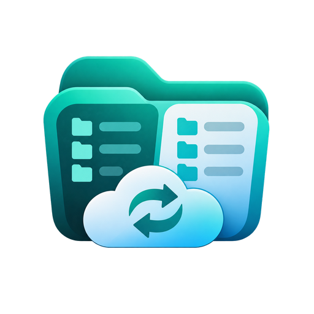
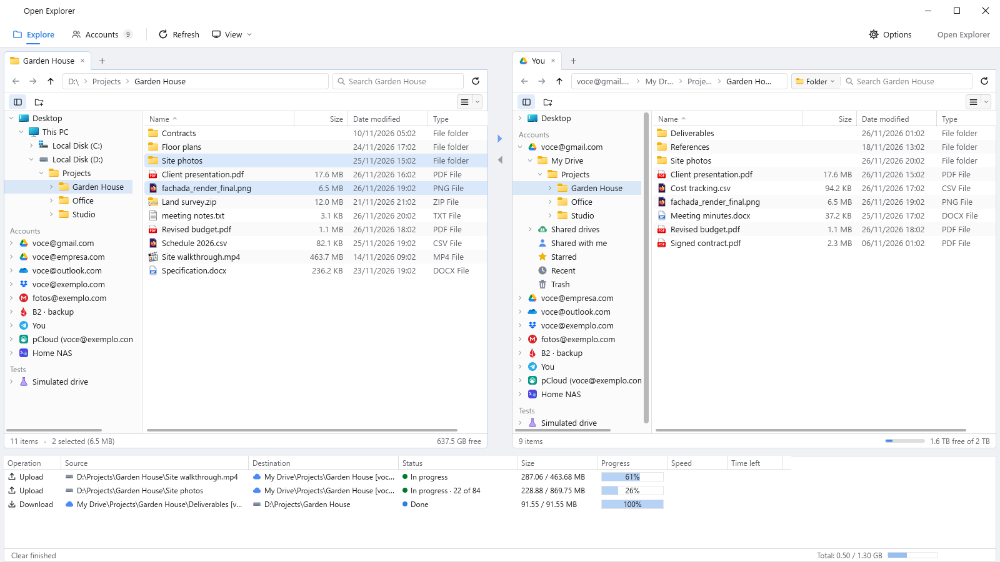
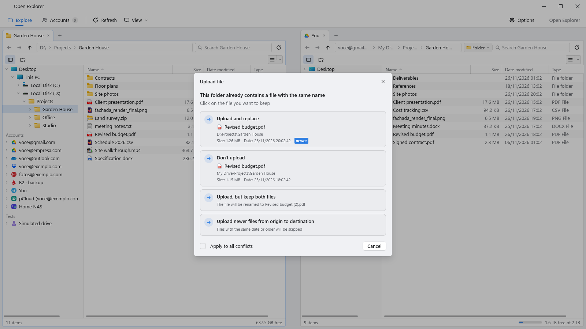
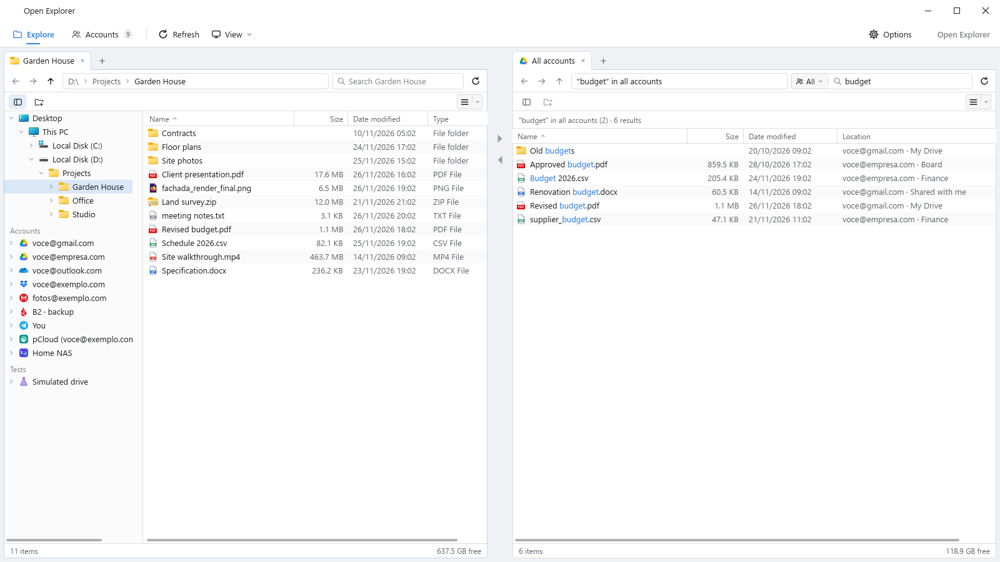
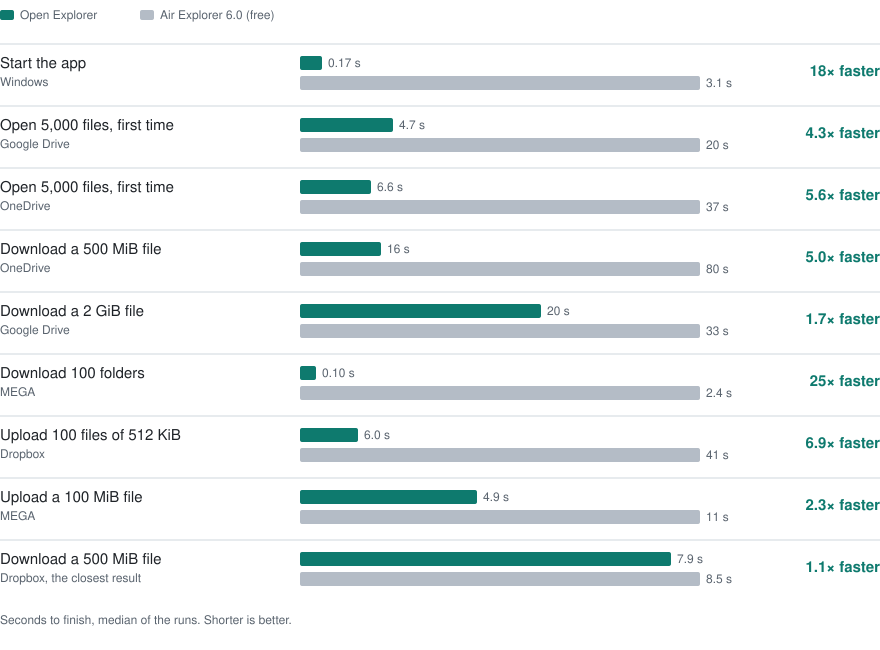

<div align="center">



# Open Explorer

[](https://github.com/orezraey/OpenExplorer/releases/latest)


A file manager with up to four panes, and Google Drive, OneDrive, Dropbox, MEGA, Backblaze B2,
Telegram, SFTP, FTP and WebDAV built in. Written in Rust.

[Features](#features) • [Install](#install) • [Speed](#speed-against-air-explorer) • [Adding accounts](#adding-accounts) • [Building](#building-from-source)

[Português](README.pt-BR.md)

<picture>
  <source media="(prefers-color-scheme: dark)" srcset="docs/screenshots/main-en-dark.png">
  
</picture>

</div>

Open Explorer shows your computer and your cloud accounts side by side, and copies and moves
files between any of them. It beat Air Explorer 6.0 in all 37 measurements of an automated
comparison, with a median of 4.8 times less time, and it starts in 0.17 s.

## Features

- One, two or four panes, each with its own tabs, folder tree and history. Each pane shows its
  files as Extra large, Large or Medium icons, as a List, or in Details.
- As many accounts as you like in each cloud: Google Drive (shared drives, starred, sharing,
  trash), OneDrive (personal, work and school), Dropbox (personal and team), MEGA (with
  two-factor sign-in and public links), Backblaze B2 and Telegram.
- SFTP, FTP and FTPS, WebDAV, Nextcloud and ownCloud. Thirteen WebDAV clouds come ready to add,
  so you type only your login: Koofr, pCloud (US and EU), Yandex Disk, Mail.ru Cloud,
  MagentaCLOUD, HiDrive (STRATO and IONOS), kDrive, Stack, InfiniCLOUD, Mail.com Cloud and Onlime
  limeDRIVE. The form says which password to use: several need an app password made on their
  website.
- Copy and move between any two places, with a transfer queue. You set how many files go at
  once, from 1 to 10. When a name is already taken at the destination, Open Explorer asks
  whether to replace, skip, keep both or copy only newer files. Folders that already exist are
  merged.
- Instant file name search on local NTFS drives, like Everything. Google Drive search covers a
  folder, a whole account or every account at once; MEGA and servers can be searched too.
- Open folders of Google Drive, OneDrive, Dropbox and MEGA update when files change elsewhere.
- Undo and redo for renames, moves, deletes and copies.
- Drag and drop to and from Windows Explorer.
- Updates itself from GitHub. Each release is signed, and Open Explorer checks the signature
  before it installs one.
- English and Portuguese.

When a name is taken at the destination:

<picture>
  <source media="(prefers-color-scheme: dark)" srcset="docs/screenshots/conflict-en-dark.png">
  
</picture>

A search of every Google account at once:

<picture>
  <source media="(prefers-color-scheme: dark)" srcset="docs/screenshots/search-en-dark.png">
  
</picture>

## Install

Download the latest version from [Releases](https://github.com/orezraey/OpenExplorer/releases/latest):

| File | What it is |
| --- | --- |
| `OpenExplorer-<version>-windows-x64-setup.exe` | Windows installer, with a Start menu shortcut and an uninstaller |
| `OpenExplorer-<version>-windows-x64-portable.exe` | Windows, runs without installing |
| `OpenExplorer-<version>-linux-x64.tar.gz` | Linux |
| `OpenExplorer-<version>-macos-universal.zip` | macOS, Intel and Apple silicon |

> [!WARNING]
> The Windows files aren't code-signed yet, so SmartScreen warns the first time you run them.
> The Linux and macOS builds are experimental, and macOS has no local file search.

The first local search offers to install the search service, which needs administrator rights
once. To remove it, run as administrator:

```
"%ProgramFiles%\OpenExplorer\openexplorer-index.exe" index uninstall
```

## Speed against Air Explorer

<picture>
  <source media="(prefers-color-scheme: dark)" srcset="docs/bench/speed-en-dark.svg">
  
</picture>

Measured on 25 and 26 November 2026 on one Windows 11 PC with an internet connection of about
1 Gbit/s, against the free version of Air Explorer 6.0.0. Both apps moved 2 files at a time,
the free version's limit. [`bench/compare.ps1`](bench/compare.ps1) drives both apps through
Windows UI Automation, as a screen reader would, so neither app was changed and anyone can run
it again. Each number is the median of several runs. Downloads were timed in alternating pairs,
because the connection's speed changes from minute to minute. The closest result, a 500 MiB
download from Dropbox, won 4 of 5 alternating rounds.

Open Explorer's time in bold, then Air Explorer's:

| | Google Drive | OneDrive | Dropbox | MEGA |
| --- | --- | --- | --- | --- |
| Open a folder of 5,000 files, first time | **4.7 s** · 20.3 s | **6.6 s** · 37.3 s | **2.7 s** · 6.0 s | **0.03 s** · 0.18 s |
| Open a folder of 1,000 folders, first time | **1.1 s** · 4.0 s | **0.03 s** · 12.1 s | **0.55 s** · 1.17 s | **0.03 s** · 0.17 s |
| Download a 500 MiB file | **6.1 s** · 8.3 s | **16.2 s** · 80.2 s | **7.9 s** · 8.5 s | **9.9 s** · 20.2 s |
| Download 100 folders | **0.47 s** · 2.3 s | **0.09 s** · 2.3 s | **0.10 s** · 2.4 s | **0.10 s** · 2.4 s |
| Upload a 100 MiB file | **4.6 s** · 7.3 s | **7.5 s** · 12.8 s | **3.0 s** · 4.9 s | **4.9 s** · 11.0 s |
| Upload 100 files of 512 KiB | **79 s** · 109 s | **44 s** · 87 s | **6.0 s** · 41 s | **66 s** · 108 s |

| | Open Explorer | Air Explorer 6.0 (free) |
| --- | --- | --- |
| Start | **0.17 s** | 3.1 s |
| Memory, idle | **189 MB** | 240 MB |
| Open `C:\Windows\System32` (5,040 items) | **0.03 s** | 0.21 s |
| Open `C:\Windows\WinSxS` (28,491 items) | **0.16 s** | 1.09 s |
| Open a cloud folder of 5,000 files again | **0.03 to 0.06 s** | 0.16 to 0.17 s |
| Download a 2 GiB file from Google Drive | **19.9 s** | 33.1 s |
| Accounts in each cloud | **As many as you like** | One |
| Files moved at once | **You choose, 1 to 10** | 2 |

Every measurement and how it was taken is in
[`bench/results/comparison.csv`](bench/results/comparison.csv). [`bench/README.md`](bench/README.md)
says how to run the comparison.

## Adding accounts

Every account starts at Add account. MEGA and the servers need only their sign-in details. The
clouds below need a step in the browser or a key.

### Google Drive

Add account → Google Drive → Connect in browser. Google shows an "app isn't verified" warning
until it finishes verifying Open Explorer: click Advanced → Go to Open Explorer. Until then,
Google also allows at most 100 users.

To use an OAuth client of your own instead, or when you build from source:

1. Create a project in the [Google Cloud console](https://console.cloud.google.com) and enable
   the Google Drive API.
2. Set up the OAuth consent screen as External. In Testing, add your account as a test user;
   Google signs out Testing apps every 7 days.
3. Create an OAuth client ID of type Desktop app and download its JSON.
4. In Open Explorer, go to Add account → Google Drive → Change Client ID and paste the JSON.

Each account keeps the client it signed in with.

### OneDrive

Add account → OneDrive opens Microsoft's sign-in in the browser. Pick the account (personal, work
or school) and allow Open Explorer to access your files.

Microsoft Graph can't list or restore a work or school account's recycle bin, so Open Explorer
reads it through SharePoint's REST API. Open the account's Trash and click Authorize in browser;
some organizations need an administrator to grant consent. Trash then lists what was deleted,
from where and when, with Restore, Delete permanently and Empty trash, and Undo brings back what
Open Explorer deleted. Without that step the account works, but shows no Trash. Personal accounts
have no Trash, because Graph doesn't list theirs, but Undo still restores what you delete. The
Personal Vault opens only on Microsoft's website or app.

<details>
<summary>Using an app registration of your own</summary>

Register an app in Microsoft Entra for "Accounts in any organizational directory and personal
Microsoft accounts", with the platform "Mobile and desktop applications" and `http://localhost`,
public client flows on, Graph `Files.ReadWrite.All`, `offline_access` and `User.Read`, and
SharePoint `AllSites.Write`. Then save `{"client_id": "…"}` to
`%APPDATA%\OpenExplorer\onedrive-client.json` or set `OPENEXPLORER_ONEDRIVE_CLIENT_ID`.

</details>

### Dropbox

Add account → Dropbox opens Dropbox's sign-in in the browser. Allow Open Explorer there.

<details>
<summary>Using an app of your own</summary>

Create an app in the Dropbox App Console with Scoped access and Full Dropbox, the scopes
`account_info.read`, `files.metadata.*`, `files.content.*` and `sharing.*`, and the redirect URI
`http://localhost:53719`. Then save `{"app_key": "…"}` to
`%APPDATA%\OpenExplorer\dropbox-client.json` or set `OPENEXPLORER_DROPBOX_APP_KEY`.

</details>

### Backblaze B2

Make an application key under Application Keys on the Backblaze website. It can cover every
bucket, one bucket or one prefix. Seeing and downloading need `listBuckets`, `listFiles` and
`readFiles`. Uploading, making folders, renaming and deleting need `writeFiles`, and Delete every
version needs `deleteFiles`. Then go to Add account → Backblaze B2 and enter the key ID and the
application key, which the website shows only once.

### Telegram

Telegram keeps your files in a private channel of your own account. Each person registers their
own Telegram app:

1. Sign in at [my.telegram.org](https://my.telegram.org/apps) with your phone number and open
   API development tools.
2. Create an app with any name that doesn't contain the word Telegram, and the platform Desktop.
3. In Open Explorer, go to Add account → Telegram, enter the api_id, the api_hash and your phone,
   then the code Telegram sends. Accounts with two-step verification also ask for its password.

Your other chats show beside the channel, read-only, as folders of months with the files sent in
each.

> [!CAUTION]
> Deleting on Telegram is permanent. There is no trash to restore from.

## Building from source

Install Rust with [rustup](https://rustup.rs). `rust-toolchain.toml` pins the toolchain version.

```
cargo build --release
cargo test --workspace
```

The UI framework, [Rune](https://github.com/anomalyco/rune), comes from its `dev` branch, pinned
in `Cargo.lock`.
