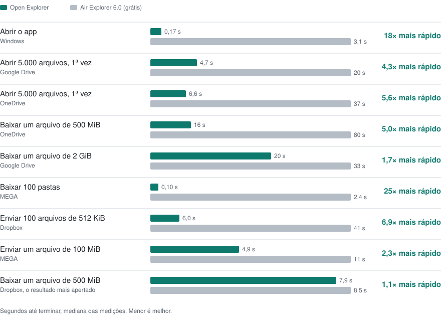

# Open Explorer

Gerenciador de arquivos de dois painéis para Windows, com Google Drive, MEGA, SFTP, FTP e WebDAV
integrados. Escrito em Rust.

[English](README.md)

<table align="center">
  <tr>
    <td align="center" width="200"><h1>37 de 37</h1><b>Medições vencidas</b><br><sub>contra o Air Explorer 6.0, no mesmo PC e na mesma conexão</sub></td>
    <td align="center" width="200"><h1>4,8×</h1><b>Menos tempo</b><br><sub>a mediana das 36 medições de tempo</sub></td>
    <td align="center" width="200"><h1>0,17 s</h1><b>Para abrir</b><br><sub>o Air Explorer leva 3,1 s</sub></td>
    <td align="center" width="200"><h1>189 MB</h1><b>Memória parado</b><br><sub>o Air Explorer usa 240 MB</sub></td>
  </tr>
</table>

## Comparado com o Air Explorer

**Mais rápido que o Air Explorer nas 37 medições: abrir pastas, baixar, enviar, abrir o app e
memória.**

<picture>
  <source media="(prefers-color-scheme: dark)" srcset="docs/bench/speed-pt-dark.svg">
  
</picture>

Medido em 25 e 26 de novembro de 2026, num PC com Windows 11 e numa conexão de cerca de
1 Gbit/s, contra a versão grátis do Air Explorer 6.0.0. Os dois apps moveram 2 arquivos por
vez, o limite da versão grátis. O script [`bench/compare.ps1`](bench/compare.ps1) controla os
dois apps pela automação de interface do Windows, como um leitor de tela faria, então nenhum
dos dois foi alterado, e qualquer pessoa pode rodá-lo de novo. Cada número é a mediana de
várias medições; os downloads foram medidos em pares alternados, porque a velocidade da conexão
muda de um minuto para o outro. O resultado mais apertado, um download de 500 MiB do Dropbox,
venceu 4 de 5 rodadas alternadas, e não todas.

O tempo do Open Explorer em negrito, depois o do Air Explorer:

| | Google Drive | OneDrive | Dropbox | MEGA |
| --- | --- | --- | --- | --- |
| Abrir uma pasta de 5.000 arquivos, 1ª vez | **4,7 s** · 20,3 s | **6,6 s** · 37,3 s | **2,7 s** · 6,0 s | **0,03 s** · 0,18 s |
| Abrir uma pasta de 1.000 pastas, 1ª vez | **1,1 s** · 4,0 s | **0,03 s** · 12,1 s | **0,55 s** · 1,17 s | **0,03 s** · 0,17 s |
| Baixar um arquivo de 500 MiB | **6,1 s** · 8,3 s | **16,2 s** · 80,2 s | **7,9 s** · 8,5 s | **9,9 s** · 20,2 s |
| Baixar 100 pastas | **0,47 s** · 2,3 s | **0,09 s** · 2,3 s | **0,10 s** · 2,4 s | **0,10 s** · 2,4 s |
| Enviar um arquivo de 100 MiB | **4,6 s** · 7,3 s | **7,5 s** · 12,8 s | **3,0 s** · 4,9 s | **4,9 s** · 11,0 s |
| Enviar 100 arquivos de 512 KiB | **79 s** · 109 s | **44 s** · 87 s | **6,0 s** · 41 s | **66 s** · 108 s |

| | Open Explorer | Air Explorer 6.0 (grátis) |
| --- | --- | --- |
| Abrir o app | **0,17 s** | 3,1 s |
| Memória parado | **189 MB** | 240 MB |
| Abrir `C:\Windows\System32` (5.040 itens) | **0,03 s** | 0,21 s |
| Abrir `C:\Windows\WinSxS` (28.491 itens) | **0,16 s** | 1,09 s |
| Abrir de novo uma pasta da nuvem de 5.000 arquivos | **0,03 a 0,06 s** | 0,16 a 0,17 s |
| Baixar um arquivo de 2 GiB do Google Drive | **19,9 s** | 33,1 s |
| Contas em cada nuvem | **Quantas quiser** | Uma |
| Arquivos movidos ao mesmo tempo | **Você escolhe, de 1 a 10** | 2 |

Cada medição, com como foi feita, está em
[`bench/results/comparison.csv`](bench/results/comparison.csv); como rodar a comparação está em
[`bench/README.md`](bench/README.md).

## Recursos

* Dois painéis, cada um com sua árvore de pastas.
* Google Drive: várias contas, drives compartilhados, compartilhamento, estrela, lixeira. As
  pastas abertas se atualizam quando algo muda na web.
* MEGA: várias contas (com login em duas etapas também), Drive na nuvem, Lixeira com restaurar,
  pastas compartilhadas com você e links públicos de arquivos. Tudo cifrado e decifrado no seu
  computador; as pastas abertas se atualizam quando algo muda em outro lugar.
* OneDrive: contas pessoais, corporativas ou de estudante, links de compartilhamento, lixeira com
  desfazer (e, nas corporativas, a Lixeira pelo SharePoint). As pastas abertas se atualizam
  quando algo muda em outro lugar.
* Dropbox: contas pessoais e de times, links compartilhados, itens excluídos com desfazer. As
  pastas abertas se atualizam quando algo muda em outro lugar.
* Backblaze B2: buckets e pastas, envios grandes em partes paralelas (e retomados), versões
  escondidas com desfazer.
* SFTP, FTP/FTPS, WebDAV, Nextcloud e ownCloud.
* Prontos para adicionar via WebDAV: [Koofr](https://koofr.eu), pCloud, Yandex Disk, Mail.ru Cloud, MagentaCLOUD,
  HiDrive (STRATO e IONOS), kDrive, Stack, InfiniCLOUD, Mail.com Cloud e Onlime limeDRIVE.
  Escolha o serviço e digite o seu login: o servidor e a pasta já vêm preenchidos, e o
  formulário diz qual senha usar (vários pedem uma senha de app criada no site deles).
* Copiar e mover entre qualquer um deles, com fila de transferências.
* Pesquisa instantânea por nome nos discos NTFS locais, parecida com o Everything. Também dá para
  pesquisar no Drive, no MEGA e nos servidores.
* Arrastar e soltar de e para o Explorer do Windows.
* Desfazer e refazer renomear, mover, excluir e copiar.
* Inglês e português.

## Instalação

Baixe a versão mais recente em [Releases](../../releases): o `setup.exe` instala o Open
Explorer com atalho no menu Iniciar e desinstalador, e o `portable.exe` roda sem instalar.
Nenhum dos dois é assinado ainda, então o SmartScreen do Windows avisa na primeira vez.

Há versões para Linux e macOS, mas são experimentais. A pesquisa no computador não existe no
macOS.

A primeira pesquisa local oferece instalar o serviço de pesquisa, o que pede permissão de
administrador uma vez. Para remover, rode como administrador:

```
"%ProgramFiles%\OpenExplorer\openexplorer-index.exe" index uninstall
```

## Google Drive

Os instaladores oficiais já vêm com o cliente OAuth do Open Explorer: vá em Adicionar conta →
Google Drive e clique em Conectar no navegador. Enquanto o app não passa pela verificação do
Google, o Google exibe o aviso "O Google não verificou este app" (clique em Avançado → Acessar
Open Explorer) e limita apps não verificados a 100 usuários.

Para usar o seu próprio cliente OAuth (ou ao compilar do código-fonte):

1. Crie um projeto no [console do Google Cloud](https://console.cloud.google.com) e ative a
   Google Drive API.
2. Configure a tela de permissão OAuth como Externo (no modo Teste, adicione sua conta como
   usuário de teste; o Google pede para entrar de novo a cada 7 dias).
3. Crie um ID do cliente OAuth do tipo App para computador e baixe o JSON.
4. No Open Explorer, vá em Adicionar conta → Google Drive → Alterar Client ID e cole o JSON.

## OneDrive

Adicionar conta → OneDrive abre o login da Microsoft no navegador: escolha a conta (pessoal,
corporativa ou de estudante), permita que o Open Explorer acesse seus arquivos, e pronto.

O Microsoft Graph não lista a lixeira de uma conta corporativa ou de estudante nem restaura dela,
então o Open Explorer a lê pela API REST do SharePoint. Abra a Lixeira da conta e clique em
Autorizar no navegador (algumas organizações exigem que um administrador conceda o
consentimento); daí em diante a Lixeira lista o que foi excluído, de onde e quando, com
Restaurar, Excluir permanentemente e Esvaziar lixeira, e Desfazer traz de volta o que o Open
Explorer excluiu. Sem isso a conta funciona como antes, sem a Lixeira. Contas pessoais não têm
Lixeira (o Graph não lista a delas); Desfazer restaura o que foi excluído. O Cofre Pessoal só abre
no site ou no app da Microsoft.

Para usar um registro de aplicativo seu (Microsoft Entra, "Contas em qualquer diretório
organizacional e contas pessoais da Microsoft", plataforma "Aplicativos móveis e da área de
trabalho" com `http://localhost`, fluxos de clientes públicos ligados, Graph
`Files.ReadWrite.All`, `offline_access`, `User.Read`, e SharePoint `AllSites.Write`), salve
`{"client_id": "…"}` em `%APPDATA%\OpenExplorer\onedrive-client.json` ou defina
`OPENEXPLORER_ONEDRIVE_CLIENT_ID`.

## Dropbox

Adicionar conta → Dropbox abre o login do Dropbox no navegador: permita o Open Explorer, e pronto.

Para usar um app seu (Dropbox App Console: Scoped access, Full Dropbox; escopos
`account_info.read`, `files.metadata.*`, `files.content.*`, `sharing.*`; URI de redirecionamento
`http://localhost:53719`), salve `{"app_key": "…"}` em
`%APPDATA%\OpenExplorer\dropbox-client.json` ou defina `OPENEXPLORER_DROPBOX_APP_KEY`.

## Backblaze B2

Crie uma chave em Application Keys, no site da Backblaze, para todos os buckets ou só um (e, se
quiser, só um prefixo). Ver e baixar pede `listBuckets`, `listFiles` e `readFiles`; enviar, criar
pastas, renomear e excluir pede `writeFiles`; Excluir todas as versões pede `deleteFiles`. Depois
vá em Adicionar conta → Backblaze B2 com o ID da chave e a chave de aplicação (o site mostra só
uma vez).

## Compilar

Instale o Rust pelo [rustup](https://rustup.rs). A versão do toolchain fica fixada no
`rust-toolchain.toml`.

```
cargo build --release
cargo test --workspace
```

O framework de interface, [Rune](https://github.com/anomalyco/rune), é usado a partir da branch
`dev` e fixado no `Cargo.lock`.
