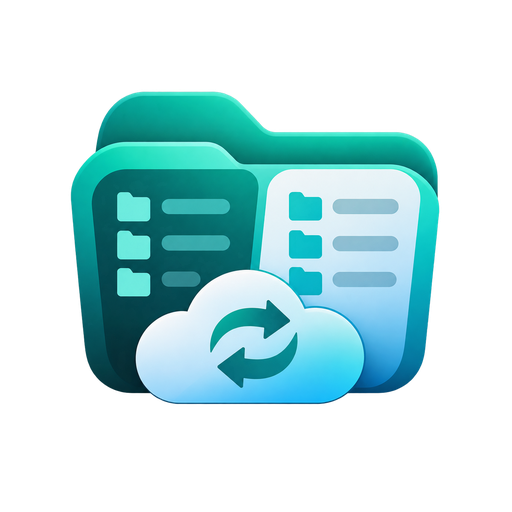
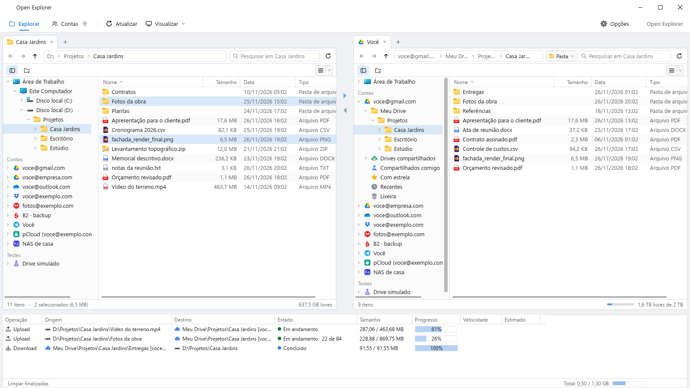
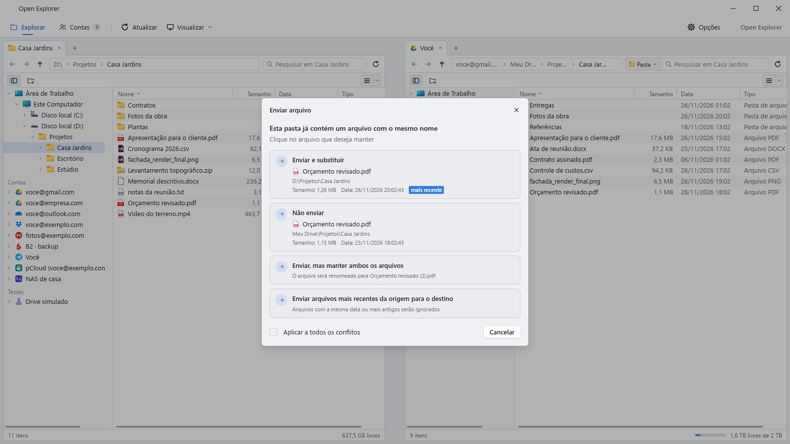
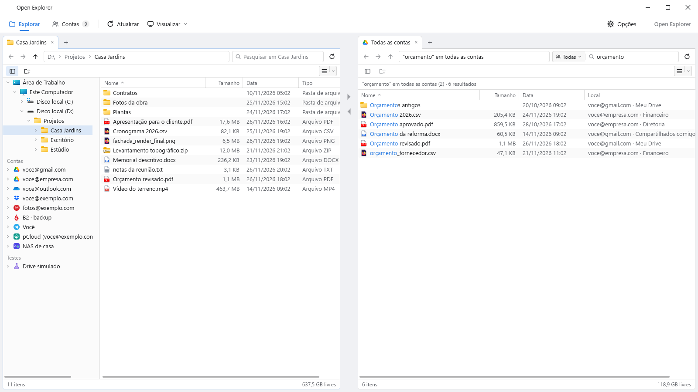

<div align="center">



# Open Explorer

[](https://github.com/orezraey/OpenExplorer/releases/latest)


Gerenciador de arquivos de até quatro painéis, com Google Drive, OneDrive, Dropbox, MEGA,
Backblaze B2, Telegram, SFTP, FTP e WebDAV integrados. Escrito em Rust.

[Recursos](#recursos) • [Instalação](#instalação) • [Velocidade](#velocidade-contra-o-air-explorer) • [Adicionar contas](#adicionar-contas) • [Compilar](#compilar)

[English](README.md)

<picture>
  <source media="(prefers-color-scheme: dark)" srcset="docs/screenshots/main-pt-dark.png">
  
</picture>

</div>

O Open Explorer mostra o seu computador e as suas contas na nuvem lado a lado, e copia e move
arquivos entre qualquer um deles. Ele venceu o Air Explorer 6.0 em todas as 37 medições de uma
comparação automática, com mediana de 4,8 vezes menos tempo, e abre em 0,17 s.

## Recursos

- Um, dois ou quatro painéis, cada um com suas abas, árvore de pastas e histórico. Cada painel
  mostra os arquivos em Ícones extra grandes, Ícones grandes, Ícones médios, Lista ou Detalhes.
- Quantas contas você quiser em cada nuvem: Google Drive (drives compartilhados, com estrela,
  compartilhamento, lixeira), OneDrive (pessoal, corporativa e de estudante), Dropbox (pessoal e
  de equipe), MEGA (com login em duas etapas e links públicos), Backblaze B2 e Telegram.
- SFTP, FTP e FTPS, WebDAV, Nextcloud e ownCloud. Treze nuvens WebDAV já vêm prontas para
  adicionar, e você digita só o seu login: Koofr, pCloud (EUA e UE), Yandex Disk, Mail.ru Cloud,
  MagentaCLOUD, HiDrive (STRATO e IONOS), kDrive, Stack, InfiniCLOUD, Mail.com Cloud e Onlime
  limeDRIVE. O formulário diz qual senha usar: vários pedem uma senha de app criada no site
  deles.
- Copiar e mover entre quaisquer dois lugares, com fila de transferências. Você escolhe quantos
  arquivos vão ao mesmo tempo, de 1 a 10. Quando o nome já existe no destino, o Open Explorer
  pergunta se deve substituir, pular, manter os dois ou copiar só os arquivos mais recentes.
  Pastas que já existem são juntadas.
- Pesquisa instantânea por nome nos discos NTFS locais, parecida com o Everything. A pesquisa no
  Google Drive vale para uma pasta, uma conta inteira ou todas as contas de uma vez; também dá
  para pesquisar no MEGA e nos servidores.
- As pastas abertas do Google Drive, OneDrive, Dropbox e MEGA se atualizam quando os arquivos
  mudam em outro lugar.
- Desfazer e refazer renomear, mover, excluir e copiar.
- Arrastar e soltar de e para o Explorer do Windows.
- Atualiza sozinho pelo GitHub. Cada versão é assinada, e o Open Explorer confere a assinatura
  antes de instalar.
- Inglês e português.

Quando o nome já existe no destino:

<picture>
  <source media="(prefers-color-scheme: dark)" srcset="docs/screenshots/conflict-pt-dark.png">
  
</picture>

Uma pesquisa em todas as contas do Google de uma vez:

<picture>
  <source media="(prefers-color-scheme: dark)" srcset="docs/screenshots/search-pt-dark.png">
  
</picture>

## Instalação

Baixe a versão mais recente em [Releases](https://github.com/orezraey/OpenExplorer/releases/latest):

| Arquivo | O que é |
| --- | --- |
| `OpenExplorer-<versão>-windows-x64-setup.exe` | Instalador para Windows, com atalho no menu Iniciar e desinstalador |
| `OpenExplorer-<versão>-windows-x64-portable.exe` | Windows, roda sem instalar |
| `OpenExplorer-<versão>-linux-x64.tar.gz` | Linux |
| `OpenExplorer-<versão>-macos-universal.zip` | macOS, Intel e Apple silicon |

> [!WARNING]
> Os arquivos para Windows ainda não têm assinatura de código, então o SmartScreen avisa na
> primeira vez. As versões para Linux e macOS são experimentais, e o macOS não tem a pesquisa
> local.

A primeira pesquisa local oferece instalar o serviço de pesquisa, o que pede permissão de
administrador uma vez. Para remover, rode como administrador:

```
"%ProgramFiles%\OpenExplorer\openexplorer-index.exe" index uninstall
```

## Velocidade contra o Air Explorer

<picture>
  <source media="(prefers-color-scheme: dark)" srcset="docs/bench/speed-pt-dark.svg">
  
</picture>

Medido em 25 e 26 de novembro de 2026, em um PC com Windows 11 e uma conexão de cerca de
1 Gbit/s, contra a versão gratuita do Air Explorer 6.0.0. Os dois apps moviam 2 arquivos por
vez, o limite da versão gratuita. O [`bench/compare.ps1`](bench/compare.ps1) controla os dois
apps pela Automação da Interface do Windows, como um leitor de tela faria, então nenhum dos dois
foi alterado e qualquer pessoa pode repetir o teste. Cada número é a mediana de várias
execuções. Os downloads foram medidos em pares alternados, porque a velocidade da conexão muda de
um minuto para outro. O resultado mais apertado, um download de 500 MiB do Dropbox, venceu 4 de
5 rodadas alternadas.

O tempo do Open Explorer em negrito, depois o do Air Explorer:

| | Google Drive | OneDrive | Dropbox | MEGA |
| --- | --- | --- | --- | --- |
| Abrir uma pasta de 5.000 arquivos, primeira vez | **4,7 s** · 20,3 s | **6,6 s** · 37,3 s | **2,7 s** · 6,0 s | **0,03 s** · 0,18 s |
| Abrir uma pasta de 1.000 pastas, primeira vez | **1,1 s** · 4,0 s | **0,03 s** · 12,1 s | **0,55 s** · 1,17 s | **0,03 s** · 0,17 s |
| Baixar um arquivo de 500 MiB | **6,1 s** · 8,3 s | **16,2 s** · 80,2 s | **7,9 s** · 8,5 s | **9,9 s** · 20,2 s |
| Baixar 100 pastas | **0,47 s** · 2,3 s | **0,09 s** · 2,3 s | **0,10 s** · 2,4 s | **0,10 s** · 2,4 s |
| Enviar um arquivo de 100 MiB | **4,6 s** · 7,3 s | **7,5 s** · 12,8 s | **3,0 s** · 4,9 s | **4,9 s** · 11,0 s |
| Enviar 100 arquivos de 512 KiB | **79 s** · 109 s | **44 s** · 87 s | **6,0 s** · 41 s | **66 s** · 108 s |

| | Open Explorer | Air Explorer 6.0 (gratuito) |
| --- | --- | --- |
| Abrir | **0,17 s** | 3,1 s |
| Memória, parado | **189 MB** | 240 MB |
| Abrir `C:\Windows\System32` (5.040 itens) | **0,03 s** | 0,21 s |
| Abrir `C:\Windows\WinSxS` (28.491 itens) | **0,16 s** | 1,09 s |
| Abrir de novo uma pasta na nuvem com 5.000 arquivos | **0,03 a 0,06 s** | 0,16 a 0,17 s |
| Baixar um arquivo de 2 GiB do Google Drive | **19,9 s** | 33,1 s |
| Contas em cada nuvem | **Quantas quiser** | Uma |
| Arquivos movidos ao mesmo tempo | **Você escolhe, de 1 a 10** | 2 |

Cada medição, com o modo como foi feita, está em
[`bench/results/comparison.csv`](bench/results/comparison.csv). O
[`bench/README.md`](bench/README.md) explica como rodar a comparação.

## Adicionar contas

Toda conta começa em Adicionar conta. O MEGA e os servidores pedem só os dados de login. As
nuvens abaixo pedem um passo no navegador ou uma chave.

### Google Drive

Adicionar conta → Google Drive → Conectar no navegador. O Google mostra o aviso "O Google não
verificou este app" até terminar de verificar o Open Explorer: clique em Avançado → Acessar Open
Explorer. Até lá, o Google também permite no máximo 100 usuários.

Para usar um cliente OAuth seu, ou ao compilar do código-fonte:

1. Crie um projeto no [console do Google Cloud](https://console.cloud.google.com) e ative a
   Google Drive API.
2. Configure a tela de permissão OAuth como Externo. No modo Teste, adicione sua conta como
   usuário de teste; o Google pede para entrar de novo a cada 7 dias.
3. Crie um ID do cliente OAuth do tipo App para computador e baixe o JSON.
4. No Open Explorer, vá em Adicionar conta → Google Drive → Alterar Client ID e cole o JSON.

Cada conta continua com o cliente com que entrou.

### OneDrive

Adicionar conta → OneDrive abre o login da Microsoft no navegador. Escolha a conta (pessoal,
corporativa ou de estudante) e permita que o Open Explorer acesse seus arquivos.

O Microsoft Graph não lista nem restaura a lixeira de uma conta corporativa ou de estudante,
então o Open Explorer a lê pela API REST do SharePoint. Abra a Lixeira da conta e clique em
Autorizar no navegador; algumas organizações exigem que um administrador conceda o
consentimento. Daí em diante a Lixeira lista o que foi excluído, de onde e quando, com
Restaurar, Excluir permanentemente e Esvaziar lixeira, e Desfazer traz de volta o que o Open
Explorer excluiu. Sem esse passo a conta funciona, mas sem a Lixeira. Contas pessoais não têm
Lixeira, porque o Graph não lista a delas, mas Desfazer restaura o que você excluir. O Cofre
Pessoal só abre no site ou no app da Microsoft.

<details>
<summary>Usar um registro de aplicativo seu</summary>

Registre um app no Microsoft Entra para "Contas em qualquer diretório organizacional e contas
pessoais da Microsoft", com a plataforma "Aplicativos móveis e da área de trabalho" e
`http://localhost`, fluxos de clientes públicos ligados, Graph `Files.ReadWrite.All`,
`offline_access` e `User.Read`, e SharePoint `AllSites.Write`. Depois salve `{"client_id": "…"}`
em `%APPDATA%\OpenExplorer\onedrive-client.json` ou defina `OPENEXPLORER_ONEDRIVE_CLIENT_ID`.

</details>

### Dropbox

Adicionar conta → Dropbox abre o login do Dropbox no navegador. Permita o Open Explorer lá.

<details>
<summary>Usar um app seu</summary>

Crie um app no Dropbox App Console com Scoped access e Full Dropbox, os escopos
`account_info.read`, `files.metadata.*`, `files.content.*` e `sharing.*`, e a URI de
redirecionamento `http://localhost:53719`. Depois salve `{"app_key": "…"}` em
`%APPDATA%\OpenExplorer\dropbox-client.json` ou defina `OPENEXPLORER_DROPBOX_APP_KEY`.

</details>

### Backblaze B2

Crie uma chave em Application Keys, no site da Backblaze. Ela pode valer para todos os buckets,
para um bucket ou para um prefixo. Ver e baixar pedem `listBuckets`, `listFiles` e `readFiles`.
Enviar, criar pastas, renomear e excluir pedem `writeFiles`, e Excluir todas as versões pede
`deleteFiles`. Depois vá em Adicionar conta → Backblaze B2 e digite o ID da chave e a chave de
aplicação, que o site mostra só uma vez.

### Telegram

O Telegram guarda os seus arquivos num canal privado da sua própria conta. Cada pessoa registra
o próprio app do Telegram:

1. Entre em [my.telegram.org](https://my.telegram.org/apps) com o seu número e abra API
   development tools.
2. Crie um app com qualquer nome que não tenha a palavra Telegram, e a plataforma Desktop.
3. No Open Explorer, vá em Adicionar conta → Telegram, digite o api_id, o api_hash e o seu
   telefone, e depois o código que o Telegram mandar. Contas com verificação em duas etapas
   também pedem a senha.

As suas outras conversas aparecem ao lado do canal, só para leitura, como pastas de meses com os
arquivos enviados em cada um.

> [!CAUTION]
> Excluir no Telegram é permanente. Não há lixeira para restaurar.

## Compilar

Instale o Rust pelo [rustup](https://rustup.rs). O `rust-toolchain.toml` fixa a versão do
toolchain.

```
cargo build --release
cargo test --workspace
```

O framework de interface, [Rune](https://github.com/anomalyco/rune), vem da branch `dev`,
fixado no `Cargo.lock`.
